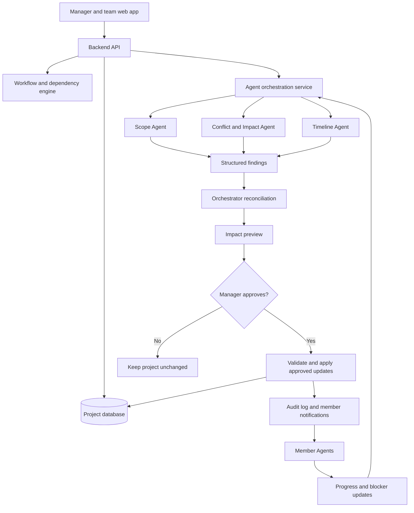

# Backstage AI — The Agentic Management System

> **Every change has a ripple. Backstage AI helps your team see it, manage it, and move forward.**

**Document type:** Product concept and technical blueprint  
**Stage:** Hackathon concept / MVP planning  
**Initial audience:** Small teams managing projects with interconnected tasks  
**Long-term scope:** Project, event, team, and operational management

---

## 1. Executive summary

**Backstage AI** is an agentic management system that understands a team's project, coordinates specialized AI agents, monitors progress, evaluates the impact of changes, and helps the team adapt without losing sight of its goals or deadlines.

The fundamental shift is from software that *records work* to software that actively helps *coordinate work*.

Imagine a manager overseeing four employees. A stakeholder suddenly requests a major change. In a traditional workflow, the manager must figure out which tasks are affected, ask employees about their capacity, resolve conflicts, revise deadlines, and communicate the new plan.

Backstage AI is designed to handle much of that coordination work through specialized agents, while keeping the manager in control of important decisions.

### In one sentence

Backstage AI is an agentic management system that coordinates people, tasks, and project dependencies, helping teams understand the consequences of change and adapt their plans intelligently.

### The core promise

**A stakeholder requests a change → specialist agents analyze the consequences → the system proposes a coordinated plan → the manager approves it → member-specific agents help the team execute it → the project plan updates as new information arrives.**

---

## 2. The origin of the idea

The idea emerged from two related problems.

### 2.1 The friction of organizing college events

Organizing a college event involves approval emails, letters of request, HOD approvals, budgets, designs, sponsors, vendors, and logistics. These activities depend on one another, and a change in one area can affect several others.

### 2.2 The broader problem of managing projects

The same coordination challenge exists in software development, product launches, company events, marketing campaigns, and other team projects.

A manager assigns tasks, but the project continues to evolve. Requirements change, employees encounter blockers, stakeholders introduce new priorities, and deadlines remain fixed.

The manager becomes the human integration layer responsible for keeping everything consistent.

**Backstage AI aims to reduce that coordination burden.** It begins with project management but is designed around the more general problem of managing dependencies, decisions, people, and change.

---

## 3. The problem we are solving

Traditional project management tools help teams organize tasks, track deadlines, and visualize progress. However, knowing that a task is delayed is different from understanding how that delay affects the rest of the project.

Five recurring problems motivate Backstage AI:

1. **Changes create ripple effects.** A stakeholder changes one requirement, potentially affecting several tasks, deliverables, and deadlines. Someone must manually discover those consequences.
2. **Coordination depends on the manager.** The manager repeatedly asks people for updates, chases blockers, checks dependencies, and communicates decisions.
3. **Plans become outdated.** The project plan may no longer reflect actual progress, newly introduced work, or the team's available capacity.
4. **Context is fragmented.** Requirements live in documents, decisions in chats, tasks in project tools, and progress updates in conversations.
5. **Problems surface too late.** Conflicts and schedule risks are often discovered after they have already caused delays.

The underlying problem is not simply that teams need better task lists. It is that **the coordination required to keep a changing project coherent is still heavily manual**.

### The key insight

A project is not just a collection of tasks. It is a changing network of goals, dependencies, people, resources, decisions, and deadlines.

A change to one part of that network may affect many other parts. Backstage AI maintains a model of those relationships and uses agents to help reason about what should happen next.

---

## 4. Product vision and positioning

Backstage AI is an **agentic management system for teams and projects**.

A manager describes a project, establishes its goals and deadlines, and assigns responsibilities. The system maintains a shared representation of the project and uses specialized AI agents to analyze changes, identify conflicts, coordinate team members, and recommend updates.

The system should continuously help answer five questions:

- What is happening across the project?
- What is blocked, delayed, or at risk?
- What happens if something changes?
- Who needs to do what next?
- Can the project still reach its goal within the available time and resources?

The product is not intended to replace human judgment. It should make the manager's decisions better informed and reduce the amount of manual coordination required.

### Positioning statement

> Backstage AI is an agentic management system that coordinates people, tasks, and project dependencies, helping teams understand the consequences of change and adapt their plans intelligently.

### Tagline options

- **Every change has a ripple. See it before it hits.**
- **Know what changes before you change it.**
- **From task tracking to change intelligence.**
- **Your project has dependencies. Your management system should understand them.**

---

## 5. Who is it for?

### Initial user: the project manager

A manager leading a small team of roughly four to ten people, responsible for delivering a project with a deadline and multiple interdependent tasks.

They need to assign work, see progress, evaluate incoming requests, resolve conflicts, and coordinate changes without personally chasing every detail.

### Other users

- **Team members:** Need clear responsibilities, task context, deadlines, and a way to report progress or blockers.
- **Stakeholders or clients:** Request changes, clarify priorities, and review proposed impacts. They do not necessarily need full project access.
- **College club organizers:** Coordinate approvals, finances, designs, sponsors, and event logistics.
- **Startup and agency teams:** Manage product development, client deliverables, launches, and scope changes.

### Initial scope

Start with small teams and a single project. Do not attempt to support complex enterprise governance, portfolio management, or dozens of external integrations in the first version.

---

## 6. The central product differentiator

Many existing project tools already support tasks, dependencies, automations, and some AI features. Backstage AI should not claim those capabilities are new on their own.

The proposed differentiator is a unified workflow:

**Natural-language change → dependency analysis → specialist-agent reasoning → coordinated impact proposal → manager approval → member coordination → updated project state.**

A traditional task tracker might record: “The login requirement changed.”

Backstage AI should help answer:

- Which tasks are directly affected?
- Which downstream tasks might need review?
- Which people need to be involved?
- What conflicts or resource constraints might arise?
- What changes are needed to the schedule?
- Is the deadline still feasible?
- What information is missing?
- What should the manager approve, reject, or clarify?

The system must explain its reasoning and distinguish known facts from inferred possibilities.

---

## 7. Core user journey

### Step 1 — Create a project

The manager describes the project in natural language.

Example:

> “We are building a customer portal in four weeks. The team has four members handling design, backend, frontend, and QA. We need requirements, implementation, testing, and release.”

Backstage AI proposes stages, tasks, milestones, owners, and dependencies. The manager edits and approves the proposed plan. AI-generated assumptions must not silently become authoritative project facts.

### Step 2 — Assign work

Each task has:

- Title and description
- Owner
- Status
- Priority
- Target date or estimated duration
- Dependencies
- Acceptance criteria
- Relevant notes or linked artifacts

Employees see their assigned work and can report progress, blockers, and revised estimates.

### Step 3 — Receive a change request

A stakeholder asks:

> “We need OTP authentication added to the customer portal, but the launch date cannot change.”

The manager sends the request to Backstage AI. If the request is ambiguous, the system asks clarifying questions rather than inventing requirements.

### Step 4 — Analyze the change

The Orchestrator coordinates three specialist agents:

1. **Scope and Pipeline Agent:** Determines what work may need to be added, changed, or removed.
2. **Conflict and Impact Agent:** Finds dependency conflicts, affected team members, incompatible assumptions, and risks.
3. **Timeline and Feasibility Agent:** Evaluates the revised work against deadlines, dependencies, and known capacity.

The agents can begin their analysis in parallel, then exchange findings during a reconciliation stage.

### Step 5 — Reconcile the proposals

The Orchestrator combines the specialist outputs into one consistent proposal. It identifies disagreements, missing information, and assumptions. If agents disagree materially, the system should show the disagreement or request clarification rather than hide it.

### Step 6 — Present an impact report

The manager sees:

- The requested change and its interpreted meaning
- Directly affected tasks
- Downstream tasks that may need review
- Affected owners and reasons
- New tasks or acceptance criteria proposed
- Potential conflicts and blockers
- Revised schedule and assumptions
- Deadline feasibility and unresolved questions

### Step 7 — Get manager approval

The manager can approve, reject, or edit individual proposed changes. Backstage AI should not silently reassign people, alter shared deadlines, or commit a new project scope.

### Step 8 — Coordinate the team

After approval, member-specific agents notify affected team members, explain what changed, and ask for relevant information such as revised estimates or availability.

### Step 9 — Adapt based on feedback

A team member reports a blocker or revised estimate. The relevant member agent reports the new information to the Orchestrator, which triggers a reassessment of the schedule and project plan when appropriate.

This creates a feedback loop: **plan → execute → observe → reassess → approve → update**.

---

## 8. Agent architecture

The product uses a coordinating Orchestrator and specialized agents with clearly defined responsibilities.

### 8.1 Orchestrator Agent

**Role:** Central coordinator and owner of the analysis workflow.

Responsibilities:

- Receive and interpret the manager's change request.
- Retrieve relevant project context.
- Dispatch structured analysis requests to specialist agents.
- Collect and compare agent outputs.
- Identify contradictions, missing data, and unsupported assumptions.
- Produce a unified change proposal.
- Request manager approval.
- Trigger approved updates and member communications.
- Maintain traceability between the original request and the final plan.

The Orchestrator should not blindly accept every agent output. It validates results and reconciles them before presenting a plan.

### 8.2 Agent 1 — Scope and Pipeline Agent

**Question it answers:** What work needs to change?

Responsibilities:

- Match the change request to existing requirements and tasks.
- Identify tasks that may need modification.
- Propose new tasks or acceptance criteria.
- Identify deliverables that may need to be revised.
- Suggest dependency changes.
- Explain why each task was flagged.

Example output:

- Add OTP issuance and verification work.
- Review the login interface for an OTP step.
- Add OTP-specific acceptance criteria.
- Update relevant documentation.

It should propose changes, not directly mutate the project database.

### 8.3 Agent 2 — Conflict and Impact Agent

**Question it answers:** What could conflict, and who might be affected?

Responsibilities:

- Traverse known task dependencies.
- Identify affected owners and downstream work.
- Detect conflicting assumptions or incompatible deliverables.
- Identify resource clashes where availability data exists.
- Flag tasks whose outputs may become stale.
- Separate recorded facts from AI-inferred potential impacts.

Example output:

- Frontend integration depends on the authentication API contract.
- Existing login tests may not cover OTP expiry and invalid-code handling.
- The backend owner has another task competing for the same time window, if the project records that commitment.

The agent must not invent a resource conflict if no availability or workload data exists.

### 8.4 Agent 3 — Timeline and Feasibility Agent

**Question it answers:** How could the team accommodate the change, and is the deadline still realistic?

Responsibilities:

- Evaluate the new work against the remaining schedule.
- Respect dependency ordering.
- Use known task estimates and team availability where available.
- Suggest parallelization of independent tasks.
- Suggest reprioritization or moving lower-priority work to a later release.
- Identify deadline risks and missing estimates.
- Explain the assumptions behind any schedule recommendation.

The agent should use deterministic scheduling calculations for date arithmetic and dependency constraints. An LLM can interpret the work and suggest options, but it should not invent precise estimates or guarantee a deadline without evidence.

### 8.5 Member-specific agents

Each team member can have a context-aware agent that knows their assigned tasks, dependencies, deadlines, project decisions, and recent updates.

Responsibilities:

- Explain assigned tasks and why they matter.
- Notify the member when an approved change affects their work.
- Ask for revised estimates or clarification.
- Collect progress and blockers.
- Suggest task-level next steps.
- Report material changes in capacity or status to the Orchestrator.

Member agents should not independently rewrite shared project scope or deadlines. They are coordinators and representatives, not unrestricted autonomous managers.

### Agent authority model

| Action | Who can propose? | Who can approve or execute? |
|---|---|---|
| Suggest new tasks | Scope Agent | Manager approves |
| Flag affected tasks | Impact Agent / graph engine | No approval needed to flag; manager decides action |
| Suggest revised schedule | Timeline Agent | Manager approves material changes |
| Ask member for an estimate | Member Agent | Can ask within configured permissions |
| Change shared deadline | Agent can propose | Manager or authorized project owner |
| Update task after approval | Orchestrator / workflow service | Executes only approved edits |
| Record progress reported by member | Member / Member Agent | Apply under defined project rules and keep history |

---

## 9. How the agents communicate

Multi-agent design should not mean several free-form conversations with no shared contract. Each agent should receive relevant project state and return a structured result.

### Suggested analysis sequence

1. Orchestrator validates the request and captures the current project version.
2. Scope Agent identifies direct task matches and proposed work.
3. Conflict Agent evaluates known dependencies and potential conflicts.
4. Timeline Agent uses the proposed work, dependency findings, durations, and available capacity to assess feasibility.
5. Orchestrator reconciles the three outputs and checks consistency.
6. The manager reviews the proposed plan.
7. The workflow service validates and applies approved changes transactionally.
8. Member agents notify affected people and gather feedback.
9. New information triggers reassessment if it materially changes the plan.

The specialists can perform initial analyses concurrently. A follow-up pass is useful because the timeline analysis should incorporate the scope and conflict findings.

### Example structured output

```json
{
  "change_request": "Add OTP authentication",
  "direct_matches": ["T3"],
  "downstream_tasks": ["T4", "T5", "T6"],
  "additional_candidates": [
    {
      "task_id": "T2",
      "reason": "The login design may need an OTP entry step",
      "basis": "ai_inference",
      "needs_review": true
    }
  ],
  "proposed_updates": [
    {
      "task_id": "T5",
      "action": "append_acceptance_criteria",
      "text": "Test OTP expiry, invalid codes, and retry behavior"
    }
  ],
  "open_questions": [
    "Will OTP be delivered by SMS or email?"
  ]
}
```

This is an illustrative contract. The implementation should validate agent output against a strict schema and reject invalid or incomplete responses.

### Communication principles

- Use stable task IDs rather than relying only on task names.
- Include evidence and reasons for every suggested impact.
- Distinguish graph-derived facts from AI inference.
- Pass only the project context each agent needs.
- Record agent outputs and manager decisions for auditability.
- Prevent an agent from applying a shared-state change outside its permissions.
- Use project-version checks to prevent stale proposals overwriting newer updates.

---

## 10. Example: a customer portal launch

Imagine a five-person team preparing a customer portal for release on November 15.

### Initial task pipeline

| ID | Task | Owner | Depends on | Status |
|---|---|---|---|---|
| T1 | Confirm requirements | Manager | — | Done |
| T2 | Design login interface | Employee A | T1 | Done |
| T3 | Build authentication API | Employee B | T1 | In progress |
| T4 | Integrate frontend login | Employee C | T2, T3 | Not started |
| T5 | Test login flow | Employee D | T4 | Not started |
| T6 | Prepare release | Manager | T5 | Not started |

### New stakeholder request

> “Add OTP authentication, but do not change the launch date.”

### Scope Agent analysis

It proposes new or revised work:

- OTP generation and verification behavior
- API contract changes
- Login interface changes
- OTP-specific testing
- Updated documentation and acceptance criteria

### Conflict Agent analysis

It flags potential issues:

- Frontend integration depends on the authentication API contract.
- Existing login tests may not cover OTP expiry, invalid codes, or retry behavior.
- The current UI design may no longer represent the complete login flow.

### Timeline Agent analysis

It assesses whether the added work fits the remaining schedule using available estimates and dependencies. It might suggest parallelizing test preparation with backend implementation, or moving lower-priority work out of the release.

If the available data is insufficient, it asks for estimates. If the deadline appears infeasible, it explicitly says so and presents trade-offs rather than fabricating a feasible plan.

### Consolidated manager report

| Area | Finding | Proposed action |
|---|---|---|
| Backend | Authentication behavior changes | Add OTP implementation work |
| UI | New verification step may be needed | Review login design |
| Integration | Depends on the agreed API contract | Confirm contract before integration |
| QA | Test coverage may be incomplete | Add OTP acceptance and failure cases |
| Release | More work may affect readiness | Reassess schedule after estimates |

These are candidate impacts, not guaranteed breakages. The system must cite the project relationships or context that support each recommendation.

### The feedback loop

The Backend Agent asks the backend developer:

> “The stakeholder requested OTP authentication. The proposed work includes OTP generation and verification. The frontend team needs the API contract before integration. Can you confirm your estimate and availability?”

The developer responds:

> “I can do it, but it will take three days instead of two because I am also fixing the payment API.”

The Member Agent records the update, the Orchestrator reassesses the schedule, and the manager receives a revised feasibility report.

That is the key behavior: the system does not just produce a plan once. It updates its recommendations as new information arrives.

---

## 11. Product features

### P0 — Essential hackathon MVP

1. **Project creation:** Create a project from a short description or a template.
2. **AI-proposed lifecycle:** Generate editable stages, tasks, and dependencies.
3. **Task assignment:** Assign owners, statuses, priorities, and due dates.
4. **Dependency graph:** Show task relationships and downstream impacts.
5. **Natural-language change request:** Manager describes a proposed change.
6. **Three specialist agents:** Scope, conflict/impact, and timeline/feasibility.
7. **Orchestrator:** Combine findings into one coherent proposal.
8. **Impact report:** Explain affected tasks, owners, risks, and assumptions.
9. **Approval workflow:** Manager accepts, edits, or rejects proposed updates.
10. **Member coordination:** Notify affected members and collect at least one response or revised estimate.
11. **Change history:** Record the request, analysis, approval, and resulting updates.

### P1 — Add if time permits

- Member-specific agent views
- Before-and-after plan comparison
- In-app notifications
- Blocked-task and project-health indicators
- Exportable impact report
- Simple project templates for software projects and events
- Real-user analytics for the hackathon

### P2 — Post-hackathon roadmap

- Integrations with Jira, Linear, Asana, Slack, GitHub, Google Drive, and calendars
- Versioned requirements and linked documents
- Multiple project types: events, campaigns, product launches, and operations
- Budget and resource impact modeling
- Organization workspaces and more granular permissions
- Cross-project dependencies
- Historical delivery data to improve estimation
- Approval policies and configurable agent permissions
- Stakeholder portal for change requests and status updates

---

## 12. What should the hackathon MVP prove?

Do not try to build a full autonomous workforce management platform in 12 hours.

The MVP should prove one complete, convincing loop:

1. A manager creates a project with four members and a dependency-based task pipeline.
2. The manager submits a stakeholder change request.
3. Three specialist agents analyze scope, conflicts, and timeline.
4. The Orchestrator combines their findings into a proposed plan.
5. The manager reviews and approves selected changes.
6. Member agents notify affected users and request confirmation or revised estimates.
7. A member reports a blocker, causing the system to reassess the schedule and update the manager's view.

If this workflow is reliable, the team can demonstrate genuine agentic coordination rather than just an AI chat window.

### What not to build during the hackathon

- A full Jira or Asana replacement
- Dozens of agent personas
- Complex enterprise permissions
- Full email, Slack, and calendar integrations
- Autonomous task execution that changes shared state without approval
- A sophisticated resource-optimization engine without reliable data
- Multiple project types at once

**Build one workflow end-to-end and make it excellent.**

---

## 13. Technical architecture

### Recommended architecture



### Suggested hackathon stack

| Layer | Suggested choice | Reason |
|---|---|---|
| Frontend | Next.js + React + Tailwind CSS | Fast development and polished UI |
| Backend | Next.js API routes or Express | Simple API surface |
| Database | Supabase/PostgreSQL | Hosted persistence, authentication options, and relational data |
| AI | A reliable LLM API with structured output | Request interpretation and specialist reasoning |
| Dependency graph | Adjacency lists or a dependency table | Sufficient for a small project graph |
| Graph visualization | React Flow or equivalent | Interactive dependency display |
| Validation | Zod or a similar schema validator | Validate structured agent responses |
| Deployment | Vercel plus a hosted database | Quick public deployment |
| Analytics | Simple event table or privacy-conscious analytics | Track genuine usage and workflow completion |

A dedicated graph database is unnecessary for the first version. A normal relational database plus an in-memory graph representation is enough for a small task network.

### Divide deterministic logic from AI reasoning

Use deterministic code for:

- Dependency traversal
- Cycle detection
- Permission enforcement
- Deadline arithmetic
- Version checks
- Approval requirements
- Database updates and audit logging

Use AI for:

- Interpreting change requests
- Mapping natural language to project context
- Suggesting missing tasks and relationships
- Explaining potential impacts
- Generating options and clarifying questions
- Summarizing member updates

This hybrid approach is more reliable than asking an LLM to invent and manage the entire project state.

---

## 14. Data model

A practical first schema might include:

### User
- `id`
- `name`
- `email`
- `role`

### Project
- `id`
- `name`
- `description`
- `manager_id`
- `deadline`
- `status`
- `version`

### ProjectMember
- `project_id`
- `user_id`
- `role`

### Task
- `id`
- `project_id`
- `title`
- `description`
- `owner_id`
- `status`
- `priority`
- `due_date`
- `estimated_duration`
- `version`

### Dependency
- `predecessor_task_id`
- `successor_task_id`
- `dependency_type`

### ChangeRequest
- `id`
- `project_id`
- `requested_by`
- `original_text`
- `interpreted_change`
- `status`
- `created_at`
- `project_version_at_analysis`

### AgentAnalysis
- `id`
- `change_request_id`
- `agent_type`
- `structured_output`
- `status`
- `created_at`

### ImpactCandidate
- `id`
- `change_request_id`
- `task_id`
- `reason`
- `basis` (`graph` or `ai_inference`)
- `proposed_edit`
- `decision`

### MemberUpdate
- `id`
- `task_id`
- `user_id`
- `update_type`
- `content`
- `created_at`

### AuditEvent
- `id`
- `actor_id`
- `project_id`
- `entity_id`
- `action`
- `before_state`
- `after_state`
- `timestamp`

For the MVP, keep the data model simple. Use project roles to distinguish managers and members, and ensure that member agents cannot bypass manager approval for shared project changes.

---

## 15. Example API endpoints

```text
POST   /api/projects
GET    /api/projects/:id
POST   /api/projects/:id/generate-plan
POST   /api/projects/:id/tasks
PATCH  /api/tasks/:id
POST   /api/projects/:id/change-requests
POST   /api/change-requests/:id/analyze
GET    /api/change-requests/:id/impact
POST   /api/change-requests/:id/approve
POST   /api/change-requests/:id/reject
POST   /api/tasks/:id/member-updates
GET    /api/projects/:id/history
```

The approval endpoint should verify that the project and task versions have not changed since the proposal was generated. If they have, the system should refresh the analysis or request a new review rather than overwriting newer work.

---

## 16. User interface

### Screen 1 — Project dashboard

Shows project stage, completion, blockers, deadlines, team members, and pending change requests.

### Screen 2 — Project workflow

Displays tasks as nodes with dependency arrows. A change request highlights the directly affected and downstream tasks.

### Screen 3 — Task details

Shows the owner, status, deadline, dependencies, acceptance criteria, notes, and progress updates.

### Screen 4 — Change request composer

The manager enters a natural-language request and answers clarifying questions when necessary.

### Screen 5 — Agent analysis and impact preview

Shows the findings from the three specialist agents, their supporting evidence, conflicts between proposals, and the consolidated recommendation.

### Screen 6 — Approval panel

The manager approves, edits, or rejects individual proposed changes. The UI clearly distinguishes proposed changes from changes already applied.

### Screen 7 — Member workspace

Each team member sees their tasks, approved changes, requests for estimates, and a way to report blockers.

### Screen 8 — History and activity

Displays change requests, agent findings, manager decisions, task updates, and notifications in chronological order.

### The primary demo moment

The manager types “Add OTP authentication.” The three agents return findings, the graph highlights affected tasks, the timeline assessment explains whether the deadline remains feasible, and the manager approves selected updates. An affected member then reports a blocker, prompting reassessment.

This should be the centerpiece of the presentation.

---

## 17. Team responsibilities

For a team of five:

| Member | Primary ownership |
|---|---|
| Member 1 — Frontend | Dashboard, task screens, workflow visualization, impact preview |
| Member 2 — Backend | Database, APIs, authentication, approvals, audit history |
| Member 3 — Agent orchestration | Orchestrator, agent prompts/contracts, structured outputs |
| Member 4 — Dependency and scheduling engine | Graph traversal, dependency validation, timeline calculations |
| Member 5 — Integration and product | End-to-end testing, UX polish, user acquisition, pitch and demo |

For a four-person team, combine backend and graph/scheduling work or have the product lead own integration testing and outreach.

Agree on API contracts and the demo scenario early so each workstream can proceed in parallel.

---

## 18. A time-boxed 12-hour build plan

| Time | Deliverable |
|---|---|
| Hour 0–1 | Freeze scope, design the data model, select the demo scenario, begin user recruitment |
| Hours 1–3 | Project/task database, basic dashboard, seeded project |
| Hours 3–5 | Dependency graph, task relationships, downstream traversal |
| Hours 5–7 | Three specialist agents and structured output validation |
| Hours 7–9 | Orchestrator reconciliation, impact preview, manager approval |
| Hours 9–10 | Member notifications, blocker response, audit history |
| Hours 10–11 | Integration tests, bug fixes, deployment, real-user testing |
| Hour 11–12 | Demo rehearsal, pitch, evidence of usage, final submission |

**Recruit users from the beginning.** Do not wait until the product is finished to find testers. Confirm the hackathon's exact user eligibility and what qualifies as a valid user before relying on a recruitment target.

---

## 19. Reliability, safety, and control

Because the product can affect people's work and deadlines, reliability is a product feature.

### Required safeguards

- **Human approval:** Shared scope, assignment, and deadline changes require approval from an authorized person.
- **Evidence and inference labels:** A recorded dependency is different from an AI-suggested possible relationship.
- **Structured outputs:** Validate every agent response against a schema.
- **No fabricated estimates:** If task duration or availability is unknown, ask rather than invent.
- **Auditability:** Preserve the original request, agent findings, manager decision, and resulting changes.
- **Version checks:** Prevent stale proposals from overwriting newer project state.
- **Permission boundaries:** Member agents cannot act beyond their configured permissions.
- **Failure handling:** If an agent fails, preserve the project state and show which parts of the analysis are incomplete.
- **Data privacy:** Use only project information that the team has permission to process, and avoid sending unnecessary sensitive data to model APIs.

### Important design principle

Agents can recommend and coordinate, but the workflow engine should enforce permissions and apply approved updates. Do not rely on the LLM itself to police its own authority.

---

## 20. Testing plan

### Core functional tests

1. **Simple dependency chain:** Changing an early task identifies all known downstream tasks.
2. **Branching graph:** A change in one branch does not incorrectly flag unrelated work.
3. **Converging dependencies:** A task reachable through multiple paths appears once.
4. **Ambiguous request:** The system asks for clarification instead of inventing details.
5. **Agent disagreement:** The Orchestrator flags incompatible recommendations or requests another analysis pass.
6. **Rejected proposal:** No project changes are applied.
7. **Partial approval:** Only selected changes are applied.
8. **Stale proposal:** A project modified after analysis cannot be overwritten by an old approval.
9. **Missing estimates:** The timeline agent reports uncertainty rather than fabricating a precise schedule.
10. **Agent outage:** Deterministic dependency analysis remains available where possible, and the incomplete AI analysis is clearly marked.

### Suggested success criteria

- A manager can create or load a project and submit a change request without assistance.
- The system completes the full analysis and approval flow reliably.
- Every impact shown has a reason and a source category.
- Rejected changes leave the project unchanged.
- Approved updates are recorded in the audit history.
- A new user can understand the primary workflow in a few minutes.

---

## 21. Getting 20 genuine users during the hackathon

The product is more valuable when an entire team joins, so recruit **team leads**, not only individual users.

### Recommended acquisition model

Aim to recruit six external teams with approximately five members each, providing a buffer above the minimum requirement.

Potential audiences:

- Other hackathon teams
- College technical clubs
- Student startup teams
- College project groups
- Small agency or freelance teams

### Recruitment message

> Hey! We're building Backstage AI, an agentic project management tool that helps teams understand how a change to one requirement affects tasks, dependencies, and deadlines. We're looking for a few teams to test it with a real or current project. Setup should take only a few minutes. Would you and your team be open to trying it and sharing honest feedback?

### Acquisition process

1. Identify prospective team leaders while the product is being built.
2. Ask whether they have a current project and whether they can test the workflow.
3. Pilot with one external team as soon as the MVP is deployed.
4. Fix onboarding issues and invite the other teams.
5. Track unique users and meaningful actions, not just landing-page visits.
6. Collect feedback and use it to improve the product and strengthen the pitch.

### Analytics events

- `project_created`
- `team_member_joined`
- `task_updated`
- `change_request_created`
- `change_analysis_completed`
- `impact_reviewed`
- `change_approved`
- `member_update_submitted`

Do not fabricate metrics. Use the event log to report genuine activity and follow the organizer's official definition of a qualifying user. If the requirement is 20 free users or five paid users, confirm whether team members invited into one workspace count and what action they must complete.

---

## 22. Business direction after the hackathon

### Phase 1 — Small teams

Validate the core change-impact workflow with student teams, clubs, and small project groups.

### Phase 2 — Startups and agencies

Support product development, client-requested changes, delivery coordination, and scope management.

### Phase 3 — Event and operations management

Introduce project templates for college events, company events, marketing campaigns, and other repeatable workflows.

### Phase 4 — Intelligence layer for existing tools

Integrate with established project management tools instead of requiring every organization to migrate. Backstage AI could analyze project context, recommend changes, and write back approved updates.

### Possible business model

A free tier for small teams, with paid plans for additional projects, usage, integrations, history, and administrative controls. Pricing and willingness to pay should be validated with real users rather than assumed.

### The long-term vision

Backstage AI could evolve from a standalone project tool into an intelligence and coordination layer that helps teams manage changing work across the systems they already use.

---

## 23. Risks and how to address them

| Risk | Mitigation |
|---|---|
| It looks like a standard project tracker with AI added | Make the change-impact workflow the centerpiece |
| Too many agents add latency and complexity | Use three clear specialists plus an Orchestrator; add member agents only where they provide a real feedback loop |
| Agents contradict one another | Use structured outputs, reconciliation, evidence, and explicit uncertainty |
| AI invents dependencies or timelines | Separate deterministic graph facts from AI inference and use calculated schedules |
| Onboarding is too slow | Provide a sample project and editable AI-generated setup |
| The scope becomes too large | Build one project lifecycle and one end-to-end change scenario |
| Users do not return or complete onboarding | Recruit team leads early and make joining a team simple |
| Existing tools already offer some similar features | Validate the exact workflow advantage and avoid claiming that dependencies or AI planning are entirely new |

---

## 24. Three-minute pitch outline

### 0:00–0:25 — Hook

> “When one requirement changes, how many other tasks does it affect? Most teams discover the consequences only after something breaks.”

### 0:25–0:50 — Problem

Explain how managers manually trace dependencies, contact employees, resolve conflicts, and revise schedules whenever a stakeholder changes direction.

### 0:50–1:45 — Live demo

Show a five-person project. Submit “Add OTP authentication.” Show the three specialist analyses, the consolidated impact report, and the revised feasibility assessment.

### 1:45–2:15 — Why it works

Explain the combination of deterministic dependency traversal, specialized agent reasoning, manager approval, and member feedback.

### 2:15–2:40 — Validation

Share actual user testing numbers, completed workflows, and one concrete piece of feedback.

### 2:40–3:00 — Vision

> “Today, Backstage AI helps small teams understand and coordinate change. Our vision is to make it the intelligence layer that keeps projects coherent as work evolves.”

---

## 25. Decisions the team should make before coding

Agree on these before implementation:

1. **Primary demo domain:** Use a software project for the first demo; position college events as another potential application.
2. **One golden scenario:** Add OTP authentication while keeping the release date fixed.
3. **Agent boundaries:** Define exactly what each agent receives and returns.
4. **Source of truth:** The database and workflow engine own project state; agents return proposals.
5. **Approval granularity:** The manager can accept or reject individual proposed edits.
6. **Timeline logic:** Use actual estimates and dependency constraints; surface uncertainty.
7. **Member feedback:** Implement one clear way for a member to report a blocker or revised estimate.
8. **User acquisition:** Assign a team member to recruit external teams immediately.
9. **Fallback:** If AI analysis fails, the app can still show deterministic downstream dependencies.
10. **Success criteria:** Agree on what must work end-to-end before adding optional features.

---

## 26. Final product definition

### What Backstage AI is

An agentic management system that coordinates project work by maintaining a shared model of tasks, dependencies, people, and deadlines, then using specialized agents to analyze changes and coordinate approved responses.

### What it is not

- Just a chatbot attached to a task board
- Merely an AI task generator
- A collection of agents that can independently mutate shared project state
- A promise that AI can predict every consequence or guarantee every deadline
- A full enterprise project management replacement in its first version

### The essential workflow

**Understand the project → monitor progress → receive a change → analyze consequences → reconcile specialist recommendations → obtain approval → coordinate the team → adapt based on feedback.**

### Final one-sentence positioning

> **Backstage AI is an agentic management system that helps teams understand the ripple effects of change and coordinate the people, tasks, and decisions needed to keep a project moving.**

### Guiding principle

Do not spend the hackathon building another task tracker. Build the strongest possible demonstration of **one change, its ripple effects, the team's response, and a manager confidently resolving it**.
